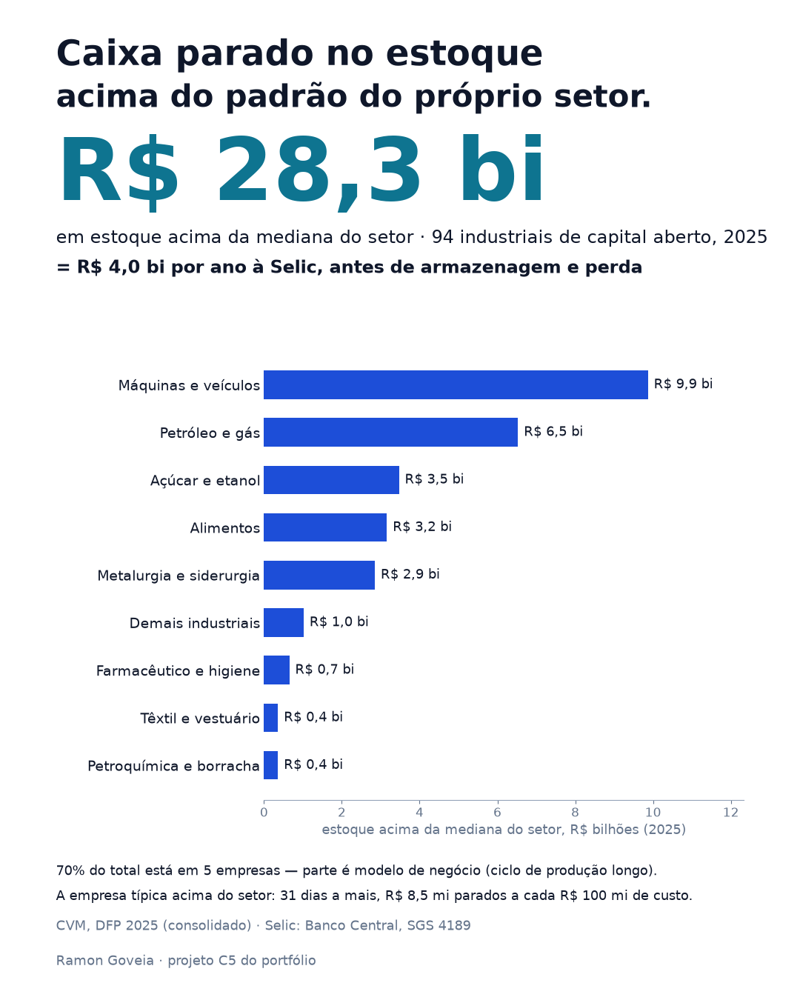

# R$ 28 bilhões parados em estoque acima do padrão do próprio setor

**Em 2025, as industriais de capital aberto mantinham R$ 28,3 bilhões em estoque acima
da mediana do próprio setor. À Selic média do ano, isso custa R$ 4,0 bilhões por ano só
de custo de oportunidade — antes de armazenagem, seguro e perda.**

**[→ Abrir o painel Caixa Parado no Estoque](https://goveiadev.github.io/c5-caixa-parado-estoque/painel/)** —
escolha setor, ano e meta, mude a taxa de juros e veja quanto cada empresa poderia
liberar reduzindo o prazo de estoque.



## A pergunta

Estoque é caixa que já saiu e ainda não voltou. **Quanto dinheiro as indústrias
liberariam se girassem o estoque no ritmo do próprio setor — e quanto custa, por ano,
manter esse excesso parado?** É a pergunta de quem cuida de capital de giro: antes de
buscar crédito, olhar o caixa que está dentro de casa.

Este projeto continua o [C2 — Raio-X Financeiro da Indústria](https://github.com/GoveiaDev/c2-raio-x-financeiro-industria).
Lá, o prazo de estoque foi o que mais afastou as empresas da mediana do setor no ciclo
de caixa (34 de 94 empresas). Aqui, ele vira reais.

## Os dados

- **[Dados abertos da CVM](https://dados.cvm.gov.br/dataset/cia_aberta-doc-dfp)** —
  demonstrações financeiras padronizadas (DFP), 2021 a 2025, balanço consolidado, e o
  [cadastro de companhias abertas](https://dados.cvm.gov.br/dataset/cia_aberta-cad),
  com o setor de cada empresa. A mesma base do C2.
- **[Selic, série 4189 do SGS do Banco Central](https://www3.bcb.gov.br/sgspub/)**
  (taxa acumulada no mês, anualizada), média de cada ano: 4,42% em 2021, 12,43% em
  2022, 13,20% em 2023, 10,84% em 2024 e 14,32% em 2025.

Mesmas regras do C2: setores industriais e de extração, receita de pelo menos R$ 50
milhões, holdings e construção civil fora, setores com menos de 5 empresas agrupados.
Em 2025: **94 industriais** fora de recuperação judicial, com **R$ 275,7 bilhões** em
estoque.

## O que eu fiz

1. **Prazo de estoque** de cada empresa = estoque de 31/12 ÷ custo do produto vendido ×
   365.
2. **Meta:** o prazo da mediana do setor no mesmo ano (cenário principal) ou do quartil
   mais curto (cenário exigente). Empresas em recuperação judicial ficam fora da meta e
   dos totais.
3. **Estoque acima da meta (R$)** = (prazo da empresa − prazo da meta) × custo do
   produto vendido por dia. Empresa abaixo da meta conta zero.
4. **Custo por ano** = estoque acima da meta × Selic média do ano.
5. **Concentração e empresa típica:** quanto do total está nas maiores, e o excesso da
   empresa mediana entre as que estão acima da meta.

| 2025 | Meta: mediana do setor | Meta: quartil mais curto |
|---|---|---|
| Estoque acima da meta | **R$ 28,3 bi** | R$ 76,0 bi |
| Empresas acima da meta | 46 de 94 | — |
| Custo por ano à Selic (14,32%) | **R$ 4,0 bi** | — |
| Nas 5 maiores | 70% | — |
| Empresa típica acima da meta | **31 dias a mais** · R$ 8,5 mi a cada R$ 100 mi de custo | — |

| Ano | Acima da mediana do setor | Selic média | Custo por ano |
|---|---|---|---|
| 2021 | R$ 34,7 bi | 4,42% | R$ 1,5 bi |
| 2022 | R$ 29,6 bi | 12,43% | R$ 3,7 bi |
| 2023 | R$ 27,5 bi | 13,20% | R$ 3,6 bi |
| 2024 | R$ 29,6 bi | 10,84% | R$ 3,2 bi |
| 2025 | R$ 28,3 bi | 14,32% | **R$ 4,0 bi** |

## O que isso significa

**O estoque caiu; o custo de carregá-lo, não.** De 2021 a 2025, o estoque acima da
mediana do setor caiu 18%. No mesmo período, o custo anual de mantê-lo subiu de R$ 1,5
bilhão para R$ 4,0 bilhões, porque a Selic média passou de 4,4% para 14,3%. Com juro
alto, o mesmo dia de estoque custa três vezes mais.

**Para a empresa típica, a conta é concreta.** Entre as 46 empresas acima da mediana do
setor, a típica tem 31 dias de estoque a mais: R$ 8,5 milhões parados a cada R$ 100
milhões de custo do produto vendido, que custam R$ 1,2 milhão por ano à Selic de 2025.

**O total é concentrado, e parte é modelo de negócio.** As 5 maiores respondem por 70%
do excesso. Fabricar aeronave ou plantar safra exige estoque que uma autopeça não
precisa — e o setor da CVM põe as duas no mesmo grupo. Por isso o painel mostra cada
empresa ao lado da faixa do setor: o número aponta onde perguntar, não o que cortar.

**O primeiro diagnóstico de capital de giro sai do balanço público.** Prazo de estoque,
meta do setor, reais acima da meta e custo do dinheiro: uma conta de minutos, antes de
qualquer projeto de redução de estoque.

## Limitações

- **Estoque alto não é, por si, desperdício.** Ciclo de produção longo, safra, estoque
  estratégico de importação e compra antecipada contra alta de preço explicam parte.
- **O setor da CVM é amplo.** Fabricante de aeronave, montadora e autopeça no mesmo
  grupo; produtor e refinador de petróleo também. A mediana de setor heterogêneo é uma
  régua imperfeita.
- **Saldo de 31/12.** É uma foto do fim do ano, não o estoque médio.
- **A DFP padronizada não separa matéria-prima, produto em processo e acabado.** Saber
  onde está o excesso exige as notas explicativas de cada empresa.
- **Selic é só o custo de oportunidade.** Armazenagem, seguro, perda e obsolescência
  ficam de fora — o custo real de carregar estoque é maior.
- **Empresa abaixo da meta conta zero.** O total mede o excesso de quem está acima, não
  um saldo do setor.
- **Só capital aberto.** As maiores; a média e a pequena indústria não estão aqui.

## Como rodar

```bash
python -m venv .venv
.venv/Scripts/pip install pandas numpy matplotlib jupyter
```

Baixe para `dados/`: `dfp_cia_aberta_2021.zip` a `dfp_cia_aberta_2025.zip` de
[dados.cvm.gov.br/dados/CIA_ABERTA/DOC/DFP/DADOS/](https://dados.cvm.gov.br/dados/CIA_ABERTA/DOC/DFP/DADOS/),
`cad_cia_aberta.csv` de
[dados.cvm.gov.br/dados/CIA_ABERTA/CAD/DADOS/](https://dados.cvm.gov.br/dados/CIA_ABERTA/CAD/DADOS/)
e a Selic:

```bash
curl "https://api.bcb.gov.br/dados/serie/bcdata.sgs.4189/dados?formato=json&dataInicial=01/01/2021&dataFinal=31/12/2025" -o dados/selic_4189.json
.venv/Scripts/jupyter nbconvert --to notebook --execute --inplace analise.ipynb
```

O notebook [`analise.ipynb`](analise.ipynb) já está salvo com as saídas executadas. Usa
os arquivos da CVM publicados em 27/09/2026.

**O painel** (`painel/`) é HTML estático, sem dependências externas. A execução do
notebook regrava `painel/dados.js`. Para abrir localmente:

```bash
python -m http.server 8000
# e abra http://localhost:8000/painel/
```

---

Ramon Goveia · [linkedin.com/in/ramon-goveia-92266443](https://www.linkedin.com/in/ramon-goveia-92266443) · projeto C5 de 16 do portfólio
